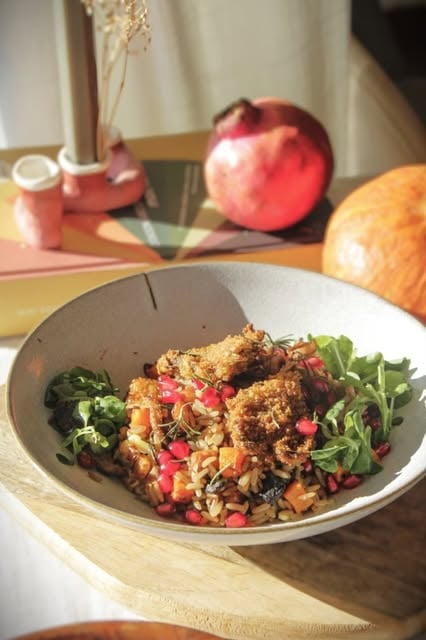

# Arroz de Abóbora, Cogumelos e Romã

## Informação

- Categoria: Pratos Principais
- Cozinha: Portuguesa
- Dificuldade: Médio

## Ingredientes

- 2 chávenas de arroz vaporizado
- 1 cebola grande, laminada
- 4 dentes de alho
- 2 folhas de louro
- 200 g de cogumelos marron, picados
- Azeite q.b.
- ⅓ chávena de vinho tinto
- 1 abóbora-manteiga média
- 1 ramo de alecrim fresco
- 100 g de cogumelos shiitake
- 100 g de cogumelos pleurotus
- 1 mão de amêndoas
- Sementes de romã q.b.

### Especiarias para o Arroz

- 2 colheres de chá de colorau
- ½ colher de chá de gengibre em pó
- Noz-moscada a gosto
- Pimenta preta a gosto
- Sal a gosto

### Tempero para o Topping

- 1 colher de sopa de melaço de romã (ou 1 c.s. de vinagre balsâmico + ½ c.s. de xarope de agave)
- 1 colher de chá de paprika fumada
- 1 colher de chá de alho em pó
- Sal a gosto

## Preparação

1. **Num tacho**, refogue a cebola laminada com o alho e as folhas de louro em azeite, em lume médio, durante 5 minutos.
2. **Adicione os cogumelos marron** picados e deixe caramelizar bem, mexendo regularmente, por 8 a 10 minutos.
3. **Corte a abóbora-manteiga** em cubos pequenos. Junte metade ao tacho, adicione as especiarias e o vinho tinto. Deixe estufar em lume brando até a abóbora ficar macia, cerca de 10 minutos.
4. **Adicione o arroz**, o dobro da água e o ramo de alecrim. Tape e deixe cozer completamente.
5. **Transfira o arroz** para uma travessa de forno. Disponha por cima o restante da abóbora, os cogumelos shiitake, os pleurotus e as amêndoas.
6. **Numa tigela**, misture os ingredientes do tempero do topping e regue os legumes por cima.
7. **Leve ao forno** a 200°C até os legumes ficarem dourados e estaladiços, cerca de 20 minutos.
8. **Sirva** com sementes de romã fresca por cima.
