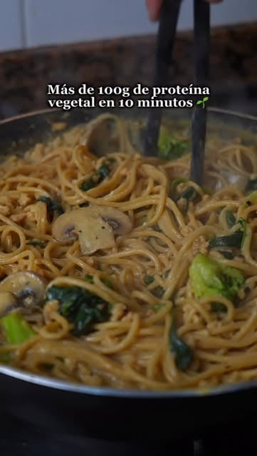

# Massa de Alta Proteína

## Informação

- Categoria: Pratos Principais
- Cozinha: Italiana
- Dificuldade: Fácil

## Ingredientes

- 200 g de esparguete (de leguminosas para mais proteína)
- 100 g de soja texturizada fina
- 50 g de espinafres frescos
- 50 g de cogumelos paris laminados
- 500 ml de leite de soja sem açúcar
- 200 ml de caldo de legumes
- 200 ml de natas vegetais (de amêndoa ou aveia)
- 40 g de levedura nutricional
- Sal e pimenta preta a gosto
- ½ colher de chá de paprika
- ½ colher de chá de gengibre em pó
- ½ colher de chá de noz-moscada
- 1 colher de chá de ervas de Provence
- Floretes de brócolos a gosto

## Preparação

1. **Numa frigideira grande** ou tacho fundo, coloque o esparguete partido ao meio, a soja texturizada, os espinafres, os cogumelos, os brócolos e as especiarias.
2. **Verta** o leite de soja, o caldo de legumes e as natas vegetais por cima de tudo.
3. **Tape** e cozinhe em lume médio, mexendo de vez em quando, para evitar que a massa se cole.
4. **Adicione mais caldo** se reduzir demasiado depressa.
5. **Quando a massa estiver al dente** e o molho cremoso, retire do lume.
6. **Adicione a levedura nutricional**, mexa bem e prove o tempero.
7. **Sirva** de imediato, polvilhado com levedura nutricional adicional se desejar.
