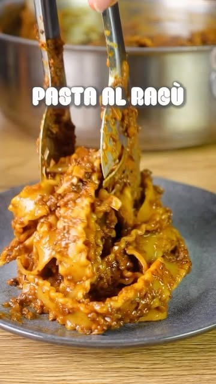

# Massa al Ragù Vegano

## Informação

- Categoria: Pratos Principais
- Cozinha: Italiana
- Dificuldade: Médio

## Ingredientes

- 100 g de nozes
- 200 g de couve-flor
- 400 g de cogumelos
- Azeite a gosto
- Sal a gosto
- 1 cebola, picada finamente
- 2 talos de aipo, picados finamente
- 5 colheres de sopa de concentrado de tomate
- 1 colher de sopa de miso (opcional, mas recomendado)
- 60 ml de vinagre balsâmico
- 1 a 2 chávenas de água (250 a 500 ml)
- Pimenta preta a gosto
- 1 colher de chá de paprika e ervas secas a gosto
- 2 folhas de louro
- 350 g de massa (tagliatelle, pappardelle ou esparguete)
- Levedura nutricional para servir

## Preparação

1. **No processador**, triture as nozes, a couve-flor e os cogumelos grosseiramente. Misture com um fio de azeite e sal.
2. **Espalhe** a mistura num tabuleiro e asse a 200°C durante 30 minutos, mexendo aos 15 minutos, até ficar dourado e levemente estaladiço.
3. **Numa frigideira grande**, refogue a cebola e o aipo em azeite por 5 minutos até ficarem macios.
4. **Adicione o concentrado de tomate** e o miso. Cozinhe por 1 a 2 minutos, mexendo, para caramelizar.
5. **Deglaze** com o vinagre balsâmico e deixe evaporar quase completamente.
6. **Junte a mistura** de nozes, couve-flor e cogumelos assados.
7. **Adicione a água**, a pimenta, a paprika, as ervas e as folhas de louro. Mexa bem e deixe fervilhar em lume brando por pelo menos 20 minutos.
8. **Coza a massa** al dente de acordo com as instruções. Reserve um pouco da água de cozedura antes de escorrer.
9. **Junte a massa** à frigideira com o ragù e um pouco da água de cozedura. Cozinhe por mais 2 minutos para a massa absorver o molho.
10. **Sirva** com levedura nutricional polvilhada por cima.
