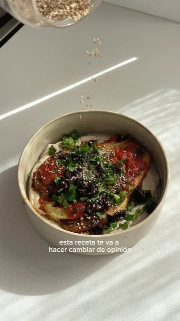

# Tofu com Beringela Assada

## Informação

- Categoria: Pratos Principais
- Cozinha: Mediterrânea
- Dificuldade: Fácil

## Ingredientes

- 400 g de tofu firme
- Sumo de ½ limão
- 2 a 3 colheres de sopa de molho de soja
- 2 colheres de sopa de azeite
- 1 colher de chá de alho em pó
- 2 colheres de sopa de levedura nutricional
- 2 beringelas, cortadas em rodelas ou cubos
- 500 ml de tomate triturado
- Azeite q.b.
- Orégãos a gosto
- Azeitonas pretas a gosto
- Salsa fresca a gosto
- Sementes de sésamo integral a gosto

## Preparação

### Preparar o Tofu

1. **Corte o tofu** em fatias ou cubos e coloque numa tigela.
2. **Marine** com o sumo de limão, o molho de soja, o azeite, o alho em pó e a levedura nutricional. Deixe marinar por pelo menos 15 minutos.
3. **Frite ou asse** o tofu marinado até ficar dourado e crocante — numa frigideira com azeite por 3 a 4 minutos de cada lado, ou no forno a 200°C por 25 minutos.

### Preparar a Beringela

1. **Num tabuleiro**, disponha as rodelas de beringela. Regue com azeite e tempere com orégãos e sal.
2. **Asse no forno** a 200°C por 20 a 25 minutos, virando a meio, até ficarem macias e douradas.

### Preparar o Molho de Tomate

1. **Numa frigideira**, aqueça um fio de azeite em lume médio. Adicione o tomate triturado e deixe cozinhar por 10 minutos até reduzir. Tempere com orégãos, sal e pimenta a gosto.

### Montagem

1. **Numa travessa**, coloque o molho de tomate como base.
2. **Disponha por cima** a beringela assada e o tofu dourado.
3. **Decore** com azeitonas pretas, salsa fresca picada e sementes de sésamo integral.
