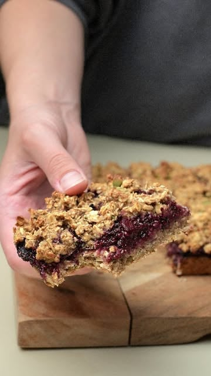

# Barras de Crumble com Amoras

## Informação

- Categoria: Sobremesas
- Cozinha: Inglesa
- Dificuldade: Fácil

## Ingredientes

### Para o Recheio de Amoras com Chia

- 2 chávenas de amoras (frescas ou congeladas)
- 2 colheres de sopa de sementes de chia
- 1 a 2 colheres de sopa de xarope de tâmaras (ou outro adoçante líquido)
- 2 colheres de chá de sumo de limão

### Para o Crumble

- 2 bananas médias maduras
- 2 colheres de sopa de manteiga de cajus (ou outra manteiga de frutos secos)
- 1 a 2 colheres de sopa de xarope de tâmaras
- ⅔ chávena de leite de soja
- 3 chávenas de flocos de aveia
- ½ chávena de farinha de amêndoa (substituir por farinha de aveia para versão sem frutos secos)
- 2 colheres de sopa de linhaça moída
- 2 colheres de sopa de sementes de cânhamo descascadas
- 2 colheres de sopa de sementes de abóbora
- 1 colher de chá de canela
- 1 colher de chá de fermento em pó
- Uma pitada de sal

## Preparação

1. **Num tacho pequeno** em lume médio, cozinhe as amoras por 5 a 7 minutos, mexendo frequentemente. Quando estiverem quentes, esmague com as costas de uma colher até obter uma consistência de compota. Retire do lume e misture as sementes de chia, o adoçante e o sumo de limão. Reserve para engrossar.
2. **Pré-aqueça o forno** a 180°C e forre uma forma quadrada com papel vegetal.
3. **Numa tigela**, esmague as bananas com um garfo. Misture a manteiga de frutos secos, o adoçante e o leite de soja até ficar incorporado.
4. **Adicione os ingredientes secos**: a aveia, a farinha de amêndoa, as sementes, a canela, o fermento e o sal. Misture bem.
5. **Transfira ⅔** da mistura de aveia para a base da forma forrada. Use as costas de uma colher ou espátula para pressionar e espalhar uniformemente. Coloque o recheio de amoras por cima e espalhe. Use os dedos para esfarelar o resto da mistura por cima para criar textura. Pressione suavemente para aderir.
6. **Leve ao forno** durante 30 minutos, rodando a meio.
7. **Deixe arrefecer** completamente antes de cortar em barras.
