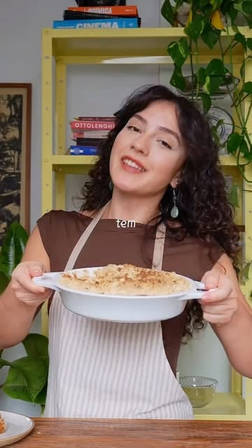

# Crumble de Banana com Doce de Leite Vegano

## Informação

- Categoria: Sobremesas
- Cozinha: Fusão
- Dificuldade: Médio

## Ingredientes

### Para o Crumble

- 1 chávena de farinha de trigo
- ⅓ chávena de açúcar
- 90 g de manteiga vegetal (não derretida, fria)
- Canela a gosto (cerca de 3 colheres de chá)

### Para o Doce de Leite Vegano

- 1 chávena de cajus demolhados (demolhar em água quente por 5 minutos)
- 1 ½ chávenas de água
- Uma pitada de sal
- Extracto de baunilha a gosto
- ¾ chávena de açúcar

### Para a Base

- 4 a 5 bananas maduras (médias)

## Preparação

### Preparar o Crumble

1. **Numa tigela**, misture a farinha, o açúcar, a manteiga vegetal fria e a canela com as pontas dos dedos, esfarelando a manteiga na farinha até obter uma textura areada.

### Preparar o Doce de Leite Vegano

1. **Triture** os cajus demolhados com a água, o sal e a baunilha no liquidificador durante 3 a 5 minutos até obter um leite suave.
2. **Numa frigideira funda**, derreta o açúcar em lume médio, sem mexer, até formar um caramelo dourado.
3. **Adicione o leite de cajus** aos poucos (cuidado pois pode salpicar). Mexa constantemente em lume médio-baixo até o doce de leite atingir a consistência desejada, cerca de 15 a 20 minutos.

### Montagem

1. **Pré-aqueça o forno** a 180°C.
2. **Coloque as bananas** num tabuleiro de forno e leve ao forno por 10 a 15 minutos até ficarem douradas por cima.
3. **Transfira as bananas** para uma travessa de forno. Regue com o doce de leite vegano.
4. **Cubra com o crumble** e leve ao forno por mais 20 minutos até ficar dourado e estaladiço.
5. **Sirva** quente ou morno, com iogurte de coco ou gelado vegano.
